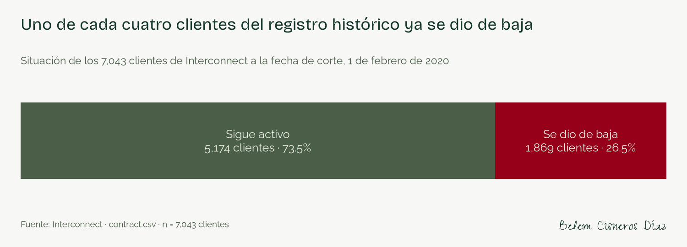
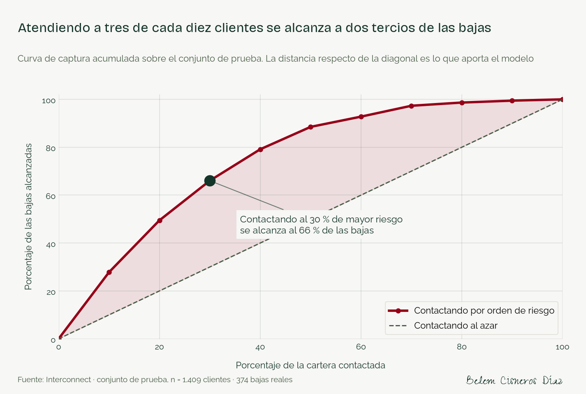
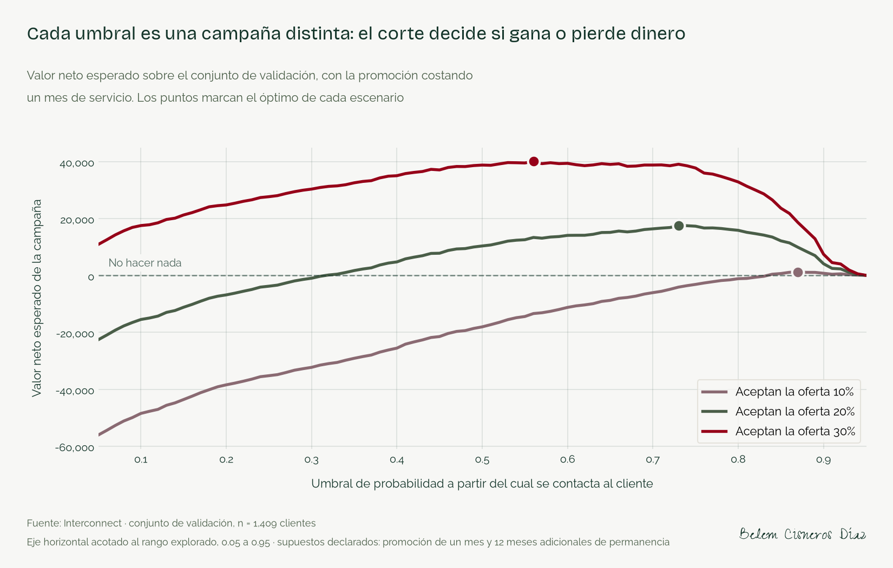
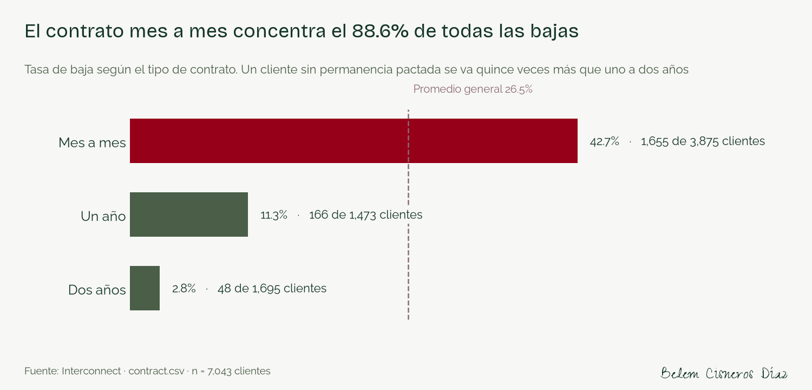
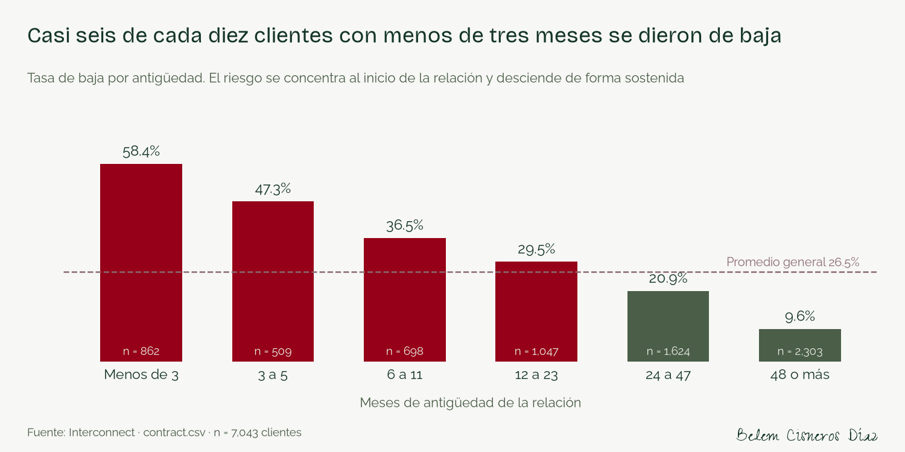
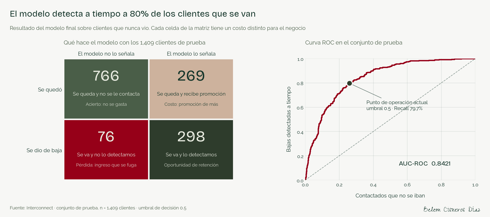
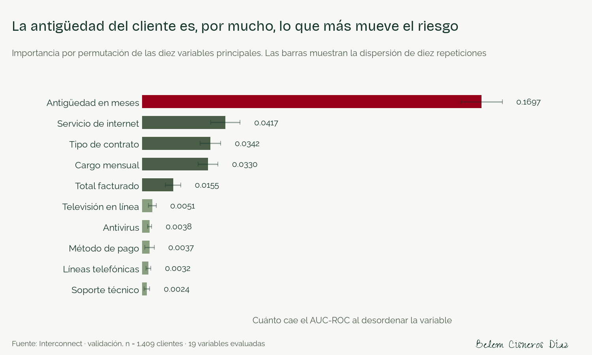

# Interconnect — Predicción de fuga de clientes


## Un tercio de la facturación se iba por la puerta y nadie sabía por cuál



Interconnect perdía clientes sin saber a quién ofrecerle una promoción. Esa es la situación real de la empresa y **no es neutral: cuesta dinero.** Repartir cupones a toda la cartera produce pérdida en **7 de los 9 escenarios** que evalué, con cifras que llegan a −177,136.

Este modelo convierte esa lotería en una lista corta, ordenada por riesgo, con el dinero calculado detrás de cada decisión.

**→ [Lee el caso de estudio completo](https://he1109-ci3l0.github.io/interconnect-fuga-clientes/)**

---

## Lo que esto le da a la empresa

| | |
|---|---|
| **139,130.85** | de facturación mensual se iba con los clientes que cancelaron: el 30.5% del registro |
| **80 de cada 100** | cancelaciones identificadas a tiempo, sobre clientes que el modelo nunca vio |
| **52,932** | de diferencia entre decidir con el modelo y repartir promociones a ciegas |

No hace falta contactar a toda la cartera. **Atendiendo al 30 % de clientes con mayor riesgo se alcanza al 66 % de quienes se van.** Contactando a ese mismo porcentaje sin criterio solo se encontraría al 30 %.



---

## La decisión que habilita

El modelo no entrega una predicción: entrega un **punto de corte con precio**. Bajarlo significa contactar a más gente, alcanzar más cancelaciones y gastar más promociones en quien no pensaba irse. Subirlo hace lo contrario. El valor neto decide dónde cortar.

Como Interconnect no proporciona el costo de una promoción ni la tasa de aceptación, los declaro como supuestos y los muevo en nueve escenarios. El umbral se elige sobre el conjunto de validación, nunca sobre el de prueba.

| Aceptan la oferta | Costo de la promoción | Umbral óptimo | Valor neto con el modelo | Ofreciendo a todos |
|---|---|---|---|---|
| 10% | 0.5 meses | 0.73 | **8,724** | -19,118 |
| 10% | 1 mes | 0.87 | **1,152** | -71,791 |
| 10% | 2 meses | 0.95 | **0** | -177,136 |
| 20% | 0.5 meses | 0.47 | **33,610** | 14,437 |
| 20% | 1 mes | 0.73 | **17,448** | -38,235 |
| 20% | 2 meses | 0.87 | **2,304** | -143,581 |
| 30% | 0.5 meses | 0.39 | **63,215** | 47,992 |
| 30% | 1 mes | 0.56 | **40,042** | -4,680 |
| 30% | 2 meses | 0.80 | **14,647** | -110,026 |



**En el escenario intermedio** —una de cada cinco personas acepta, la promoción cuesta un mes de servicio— el umbral es **0.73**. Aplicado al conjunto de prueba contacta a **310 de 1,409 clientes**, detecta **202 de las 374** cancelaciones y deja **15,216** de valor neto, frente a **-37,716** si se ofreciera a todos.

Y en el escenario más adverso —10 % de aceptación, promoción de dos meses— ningún umbral produce valor positivo: **la recomendación es no lanzar la campaña**. Un sistema que solo sabe decir «contacte a estos» no sirve para aprobar un presupuesto; este también dice cuándo no vale la pena gastar.

---

## Dónde actuar primero

| Segmento | Tasa de baja | Acción propuesta |
|---|---|---|
| Contrato mes a mes | **42.7%** · concentra el 88.5% de las cancelaciones | Incentivo de migración a contrato anual con meses bonificados |
| Menos de tres meses de antigüedad | **58.4%** | Programa de bienvenida con contacto en el primer y segundo mes |
| Pago con cheque electrónico | **45.3%** | Migración a domiciliación con un beneficio asociado |
| Fibra óptica | **41.9%** | Empaquetar soporte técnico o antivirus antes de descontar |



El riesgo se decide al principio de la relación, no cuando el cliente avisa: **58.4% de quienes llevan menos de tres meses cancelan**, contra 9.6% de quienes llevan cuatro años o más.



**El siguiente paso que recomiendo** es un piloto de un trimestre con grupo de control: dividir la lista de riesgo en dos mitades al azar, ofrecer la promoción solo a una y comparar la permanencia. Es lo único que convierte los supuestos de este análisis en cifras propias de la empresa.

---

## El resultado técnico

Medido **una sola vez** sobre 1,409 clientes que el modelo nunca había visto:

| Métrica | Resultado | Lectura |
|---|---|---|
| AUC-ROC | **0.8421** | Entre un cliente que se fue y uno que se quedó, acierta cuál es cuál en 84 de cada 100 casos |
| Recall | **0.7968** | Identifica 80 de cada 100 cancelaciones |
| Precisión | 0.5256 | De cada 100 señalados, 53 se iban de verdad |

El mínimo exigido era 0.75. El modelo constante, que predice que nadie se va, obtiene 0.5000 de AUC-ROC y **0 de Recall**: acierta el 73.5 % de las veces sin detectar a un solo cliente en riesgo. Esa comparación es la que descarta la exactitud como métrica.



**Modelo elegido:** regresión logística con ajuste de pesos (`C=1.6307`, `solver=liblinear`, `class_weight=balanced`).

<details>
<summary><b>Comparación completa de modelos</b></summary>

Baseline, sin ninguna técnica de balanceo:

| Modelo | AUC-ROC | Recall |
|---|---|---|
| Modelo constante | 0.5 | 0.0 |
| Regresión logística | 0.8356 | 0.5749 |
| Bosque aleatorio | 0.8157 | 0.5107 |
| LightGBM | 0.8228 | 0.5455 |

Tras optimizar hiperparámetros con `RandomizedSearchCV` y validación cruzada estratificada:

| Candidato | AUC-ROC | Recall | Precisión |
|---|---|---|---|
| Regresión logística · baseline | 0.8356 | 0.5749 | 0.6305 |
| Regresión logística · optimizada | 0.8356 | 0.5749 | 0.6324 |
| Regresión logística · optimizada con ajuste de pesos | 0.8354 | 0.8075 | 0.4855 |
| Bosque aleatorio · optimizado | 0.8365 | 0.7968 | 0.4958 |
| LightGBM · optimizado | 0.8374 | 0.8021 | 0.491 |

La diferencia entre el mejor modelo de árboles y la regresión logística es de 0.0020, mientras que la variabilidad entre particiones de la validación cruzada es de 0.0163: ocho veces mayor. Es un empate técnico, y en el empate pesan el Recall más alto, la interpretabilidad y el costo de operación.

</details>

---

## Hallazgos

1. **El contrato mes a mes concentra el 88.5% de todas las cancelaciones**, con 42.7% de tasa frente al 2.8% del contrato a dos años.
2. **El riesgo se decide en los primeros meses**, no al final.
3. **El cheque electrónico y la fibra óptica son focos de fuga.** No son causas: la fibra es el servicio más caro y atrae a clientes sensibles al precio.
4. **La antigüedad domina el modelo.** Desordenarla cuesta 0.1697 de AUC-ROC; la segunda variable más influyente cuesta 0.0417.
5. **Hay variables que no informan.** El género separa 0.8 puntos porcentuales. Está en los datos y no aporta: también eso se reporta.
6. **Equilibrar las clases no mejora el modelo, mueve el umbral.** El AUC-ROC apenas cambia entre tratamientos mientras el Recall salta de 0.5749 a 0.8075. De ahí se sigue que el umbral es una decisión de negocio.



---

## Cómo está hecho

1. **Unión** de los cuatro archivos por `customerID`, verificando que la llave es única y que el número de clientes no cambia.
2. **Variable objetivo** construida desde la fecha de término del contrato.
3. **Antigüedad en meses**, medida hasta la cancelación para quien se fue y hasta la fecha de corte (2020-02-01) para quien sigue activo. La fecha de término se elimina del conjunto de entrada, con comprobación explícita de que no sobrevive ninguna columna derivada.
4. **Ausencia de servicio** codificada como categoría propia, no como dato faltante.
5. **Codificación doble** dentro de un `Pipeline`: One-Hot para el modelo lineal, ordinal para los de árboles, de modo que el ajuste ocurra solo con datos de entrenamiento.
6. **División estratificada** 60 / 20 / 20 con semilla fija, verificando la proporción de bajas en las tres partes.
7. **Baseline sin balanceo**, después ajuste de pesos y sobremuestreo, y búsqueda de hiperparámetros con `scoring="roc_auc"`.
8. **Prueba evaluada una sola vez.** El umbral de operación se elige en validación.

### Estructura

```
notebooks/   análisis completo: plan, código, informe y capa de negocio
figures/     las nueve figuras del notebook en PNG a 150 ppp
resultados/  metricas.json, fuente única de todos los números
assets/      tipografías .ttf registradas en matplotlib sin instalarlas
docs/        caso de estudio publicado en GitHub Pages
```

Los datos de origen **no se versionan**: se descargan del [archivo comprimido original](https://practicum-content.s3.us-west-1.amazonaws.com/new-markets/Spreadsheets_for_DA/datasets/final_provider.zip) y se colocan en una carpeta `data/` en la raíz.

### Reproducción

```bash
conda env create -f environment.yml
conda activate interconnect-fuga-clientes
python -m ipykernel install --user --name interconnect-fuga-clientes --display-name "Python (interconnect-fuga-clientes)"
jupyter lab notebooks/interconnect_fuga_clientes.ipynb
```

El notebook busca los datos primero en `/datasets/final_provider/` y, si no existe, en `../data/`. Se ejecuta completo en unos cinco minutos.

---

## Salvedades

- `environment.yml` se exportó del entorno real pero **no se ha probado creando un entorno limpio desde cero**.
- El requisito mínimo es scikit-learn 1.2, por el parámetro `sparse_output` del codificador One-Hot.
- El modelo **no está calibrado**: el ajuste de pesos desplaza sus probabilidades hacia arriba, de modo que sirven para ordenar clientes por riesgo, no para leerse como probabilidad absoluta.
- Las cifras de dinero dependen de tres supuestos declarados que la empresa no proporciona.
- El repositorio todavía no incluye módulos en `src/` ni el modelo serializado en `models/`.

---

**Belem Cisneros Díaz** · [github.com/he1109-ci3l0](https://github.com/he1109-ci3l0)

Datos proporcionados por TripleTen para el proyecto final del bootcamp de Ciencia de Datos.
